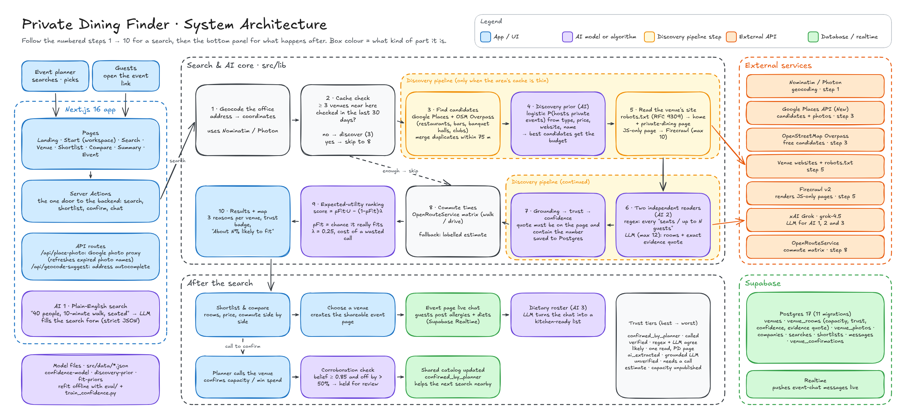

# Private Dining Finder

**Find a private dining room that actually fits your group, with evidence behind every number.**

Enter an office address, a headcount and a maximum commute. Private Dining Finder returns a ranked list of venues with a private space for your group. Every capacity and price figure carries a trust label saying how far to believe it, and every ranking explains why.

Built with Next.js 16, Supabase and xAI Grok · CECS 451 (Artificial Intelligence) project

---

## Table of contents

1. [Project description](#1-project-description)
2. [Problem](#2-problem)
3. [Solution](#3-solution)
4. [Architecture and project structure](#4-architecture-and-project-structure)
5. [AI algorithms](#5-ai-algorithms)
6. [Getting started](#6-getting-started)
7. [Limitations and next steps](#7-limitations-and-next-steps)

---

## 1. Project description

### Demo video

> 🎬 **Coming soon.** A YouTube walkthrough of the full flow (search, rank, shortlist, event chat) will be linked here.
>
> `[▶ Watch the demo](https://youtu.be/VIDEO_ID)`

### Architecture walkthrough

> 🎬 **Coming soon.** A short video explaining the diagram in [section 4](#4-architecture-and-project-structure) will be linked here.
>
> `[▶ Watch the architecture explanation](https://youtu.be/VIDEO_ID)`

### What it does

| Feature | Description |
| --- | --- |
| **Search** | Search by address, headcount, commute limit, walk or drive, and room style. You can also describe the event in plain English and let the AI fill in the form. |
| **Live discovery** | When an area has too few known venues, the app finds new ones, reads their websites, and extracts room capacities with evidence. |
| **Honest ranking** | Venues are ranked by the *probability they really fit* your group, combined with commute and room fit. Each result shows three reasons, such as "About 82% likely to fit your group". |
| **Trust labels** | Every capacity and price figure is labelled `confirmed_by_planner`, `verified`, `likely`, `ai_extracted` or `unverified`. |
| **Shortlist and compare** | Save candidates, compare rooms, prices and commute side by side, then choose one. |
| **Event page** | A shareable live page where guests post allergies and dietary needs (Supabase Realtime). The AI turns the chat into a kitchen-ready roster. |
| **Shared catalog** | A planner who calls a venue can confirm the real number. It improves results for everyone searching nearby, and figures that contradict strong evidence are held for review. |

Private Dining Finder is a research and coordination tool. It never books, holds or pays for anything.

### Screenshots

| New York (Times Square) | San Francisco (Salesforce Tower) | Waikiki (Hilton Hawaiian Village) |
| --- | --- | --- |
|  |  |  |

---

## 2. Problem

Booking a private room for 30 to 200 people is research disguised as a search box.

- **No data source answers the real question.** There is no API for "a restaurant with a private room that seats fifty." The answer is scattered across each venue's events page, PDFs, JavaScript-rendered sites and phone calls.
- **Capacity is written inconsistently.** Sites say "seats 40", "up to 120 guests for receptions", or "our Garden Room is perfect for intimate gatherings". Many publish no number at all.
- **Numbers carry hidden uncertainty.** A planner's spreadsheet mixes confirmed figures, guesses and outdated listings, with no way to tell them apart.
- **Naive automation makes it worse.** A keyword scraper reads "our dining room seats 180" from a homepage and reports a private room for 180. A language model asked to summarise a page can invent a number that isn't there.

The costly failure isn't picking the second-best restaurant. It's arriving with 60 people at a room nobody confirmed could hold more than 40.

---

## 3. Solution

Private Dining Finder treats every number as a **claim that needs evidence**. It ranks venues by how likely that claim is to be true.

1. **Discover.** Find nearby candidates with Google Places and OpenStreetMap, and spend the paid API budget on the ones most likely to host private events.
2. **Read with two independent readers.** A pattern matcher and a language model each read the venue's private-dining page. The model must copy the exact sentence that supports each number.
3. **Verify.** A model answer is kept only if its quoted sentence is really on the page and contains the number. When both readers agree, the figure is `verified`.
4. **Score confidence.** Each room gets a probability that its capacity is correct, computed from the evidence behind it.
5. **Rank by expected utility.** A guessed capacity can never outrank a published one just because the guess happens to fit better.
6. **Learn from planners.** Phone-confirmed figures flow back into the shared catalog, with a safeguard against obvious typos.

The app runs end to end with only Supabase keys. Every paid service (Google Places, Firecrawl, xAI, OpenRouteService) has a free, clearly labelled fallback.

---

## 4. Architecture and project structure

### System architecture



> The editable source is [`architecture/architecture.excalidraw`](architecture/architecture.excalidraw). Open it at [excalidraw.com](https://excalidraw.com) with **Open → choose file**.

**How to read it.** Follow the numbered steps **1 → 10** for a single search, then the *After the search* panel. Box colour shows the kind of component: app/UI, AI model, discovery step, external API, or database.

| Step | What happens | Where |
| --- | --- | --- |
| 1 | Geocode the office address | `src/lib/geo/geocode.ts` |
| 2 | Cache check: are there at least 3 venues nearby, checked in the last 30 days? If so, skip to step 8. | `src/lib/discovery/ensure-coverage.ts` |
| 3 | Find candidates (Google Places and OSM Overpass); merge duplicates within 75 m | `src/lib/discovery/places.ts` |
| 4 | Discovery prior orders candidates, so the budget goes to likely hosts | `src/lib/discovery/discovery-prior.ts` |
| 5 | Check robots.txt, scrape the site, and render JS-only pages with Firecrawl | `scraper.ts`, `robots.ts`, `render.ts` |
| 6 | Two independent readers: regex candidates and an LLM with evidence quotes | `scraper.ts`, `llm-extract.ts` |
| 7 | Grounding check → trust tier → confidence score → save to Postgres | `grounding.ts`, `trust.ts`, `confidence.ts` |
| 8 | Commute times (OpenRouteService matrix, with a labelled fallback) | `src/lib/geo/commute.ts` |
| 9 | Expected-utility ranking | `src/lib/ranking.ts` |
| 10 | Result cards and map, with reasons and trust badges | `src/components/venue-card.tsx` |

### Technology stack

| Layer | Technology |
| --- | --- |
| Framework | Next.js 16 (App Router, Server Components, Server Actions), React 19, TypeScript |
| UI | Tailwind CSS 4, shadcn/ui, Leaflet (2D map), MapLibre GL (3D map) |
| Database | Supabase: Postgres 17, Row-Level Security, Realtime |
| LLM | xAI Grok `grok-4.5`, plain `fetch`, temperature 0, strict JSON-schema output |
| Venue data | Google Places API (New), OpenStreetMap Overpass |
| Page rendering | Firecrawl v2 (only for JavaScript-only pages) |
| Routing and geocoding | OpenRouteService Matrix, Nominatim, Photon |
| Testing | Vitest (226 tests), Playwright |
| Offline ML | Python, scikit-learn (training and metric cross-checks only) |

### Project structure

```
CECS451/
├── architecture/              Architecture diagram (.excalidraw + .png) and result screenshots
├── eval/                      Offline evaluation harness: metrics, baselines, label templates
├── public/                    Static assets (curated venue photos)
├── scripts/
│   ├── seed.ts                Load the curated starter venues, then look up their photos
│   ├── backfill-photos.ts     Add real Google photos to venues that have none
│   ├── test-scenarios.ts      Run the 3 reference searches end to end
│   ├── eval-*.ts              Snapshot pages, score extraction, NDCG@5, Cohen's kappa
│   ├── train_confidence.py    Refit the logistic models from labelled data
│   └── verify-*.ts            Live checks against the real external services
├── src/
│   ├── app/                   Routes: /, /start, /search, /venue/[id], /shortlist,
│   │   │                      /compare, /summary/[code], /event/[code]
│   │   ├── actions.ts         Server Actions (every write goes through here)
│   │   └── api/               place-photo (Google photo proxy), geocode-suggest
│   ├── components/            UI: search form, venue card, map, event chat, dietary panel
│   ├── data/                  Curated venues + model coefficients (*.json)
│   └── lib/
│       ├── discovery/         Places, scraper, robots.txt, render, LLM extraction,
│       │                      grounding, trust table, confidence, discovery prior, pipeline
│       ├── geo/               Geocoding, commute matrix, bounding boxes
│       ├── ranking.ts         Expected-utility ranking
│       ├── nl-query.ts        Plain-English search → form fields (LLM)
│       ├── dietary-summary.ts Event chat → dietary roster (LLM)
│       ├── corroboration.ts   Hold contradicting planner confirmations for review
│       └── supabase/          Database clients and types
├── supabase/migrations/       Database schema, 0001 → 0011 (apply in order)
└── NOTES-ai-core.md           Engineering notes, design decisions and references
```

---

## 5. AI algorithms

The system uses three LLM tasks and four small, explainable models. Every model is a JSON file in `src/data/` that can be retrained from labelled data.

### 5.1 Overview

| # | Component | Type | Purpose |
| --- | --- | --- | --- |
| A | Plain-English search | LLM (structured output) | Turn "40 people, 10-minute walk, seated" into search fields |
| B | Capacity extraction | Regex + LLM (two readers) | Read room names and capacities from a venue's site |
| C | Grounding check | Deterministic verifier | Reject any model answer the page doesn't literally support |
| D | Capacity confidence | Logistic regression | Probability that a stored capacity is correct |
| E | Discovery prior | Logistic regression | Probability that a candidate hosts private events |
| F | Expected-utility ranking | Decision theory | Rank venues by the expected value of calling them |
| G | Dietary roster | LLM (structured output) | Summarise guests' chat messages into per-person needs |

All three LLM tasks call **xAI Grok `grok-4.5`** at temperature 0 with a strict JSON schema, so output is predictable and machine-checkable. Each has input caps, a timeout and a non-AI fallback, so the app keeps working when the model is unavailable.

### 5.2 Two-reader capacity extraction

A venue's capacity is read twice, independently:

- **Reader 1, the pattern matcher.** It finds every phrase like "seats 40" or "up to 120 guests". For each one it records the surrounding sentence and the nearest room name ("Garden Room"). It drops values below 6 and reservation phrasing ("table for 2").
- **Reader 2, the language model.** It reads the venue's private-dining page, up to 12,000 characters, and returns each room's capacity with an `evidenceQuote`: the exact sentence that states it.

Reading the private-dining page instead of the homepage matters. A homepage line like "our main dining room seats 180" is not a private room.

### 5.3 Grounding check (hallucination guard)

A model answer is accepted only if **both** of these hold:

1. its `evidenceQuote` appears on the page, after normalising case, whitespace and quote marks; and
2. the quote contains the capacity number, written as digits or as words ("forty").

Anything else is discarded as a likely hallucination. This follows the citation-checking idea of ALCE (Gao et al., 2023), but uses an exact, deterministic match instead of a second model.

### 5.4 Trust table

The two readers are reconciled into a trust tier:

| Situation | Tier |
| --- | --- |
| A planner called the venue and confirmed it | `confirmed_by_planner` |
| Regex (from the private-dining page) and the grounded LLM agree within 20% | `verified` |
| Both read the same room but disagree, or regex alone on the private-dining page | `likely` |
| Grounded LLM reading only | `ai_extracted` |
| Regex reading from the homepage only | `unverified` |
| No number anywhere: category estimate, shown as "Capacity unpublished" | `is_estimate` |

### 5.5 Capacity confidence (logistic regression)

Each room gets a probability that its capacity is correct:

```
confidence = σ(b + Σ wᵢ · xᵢ)        where σ(z) = 1 / (1 + e^(−z))
```

The features `xᵢ` describe the evidence:
- which readers found the number;
- how far apart their readings are;
- whether a private-dining page was found;
- the number of competing figures;
- whether a room name was attached;
- whether the page needed JavaScript rendering;
- the venue's category.

The feature vector is stored with every room, so the model can be retrained on real outcomes with `scripts/train_confidence.py`. Calibration is measured with Expected Calibration Error (Guo et al., 2017).

### 5.6 Discovery prior (logistic regression)

Paid API calls are limited per search: 10 Firecrawl renders and 12 LLM reads. Before any are spent, every candidate gets a score:

```
P(hosts private events) = σ(b + w · features)
```

The features are the Google place type (banquet hall, hotel, steakhouse, fast food…), price level, whether the venue has a website, and name keywords. Candidates are processed in this order, so the budget goes to the venues most likely to have a private room.

### 5.7 Expected-utility ranking

Ranking answers one question: **how worthwhile is it to call this venue?**

```
pFit  = probability the venue really has a space for the group
      = p · 1[room fits] + (1 − p) · q        (p = capacity confidence)
      = q                                     if the capacity is only an estimate

U     = 0.5 · commute score + 0.35 · capacity fit + 0.15 · style match

score = pFit · U − (1 − pFit) · λ             λ = 0.25, the cost of a wasted call
```

`q` is a base rate: how likely a venue of this category (restaurant, bar, hotel, banquet hall…) is to have a space for `h` guests. It's modelled as a logistic curve in headcount.

Venues with `pFit < 0.2` are dropped, and so are rooms that are confidently too small. Ties break on `pFit`, then commute, then name, so results are deterministic. This is the *maximum expected utility* principle (Russell & Norvig, ch. 16). An unconfirmed guess earns its utility only in proportion to how much it is believed.

### 5.8 Safeguards around the AI

- **robots.txt (RFC 9309).**
  - The longest matching rule wins, and Allow wins a tie.
  - A 4xx response means the site may be read.
  - A 5xx or unreachable robots.txt means the site is skipped, with a note telling the planner to call.
- **Planner corroboration.** A planner's confirmation is held for review instead of applied when the room's confidence is ≥ 0.85 and the new figure differs by more than 50%.
- **Pipelined budgets.** Scraping and LLM calls run on separate queues, each 8 wide, so a slow model call never blocks scraping.

### 5.9 Evaluation

`eval/` contains an offline harness that compares the original logic, regex-only, LLM-only and the combined system. It reports:

| Metric | Measures |
| --- | --- |
| Capacity accuracy, precision / recall / F1 | Extraction quality |
| Grounding rejection rate | How often the model's answer was unsupported |
| Expected Calibration Error (10 bins) | Whether confidence matches reality |
| NDCG@5 (gain 2^rel − 1) | Ranking quality against human judgments |
| Cohen's κ | Agreement between two human labellers |

The metrics are cross-checked against scikit-learn. See [`eval/README.md`](eval/README.md) for the workflow.

---

## 6. Getting started

### Prerequisites

- **Node.js 20+** and npm
- A **Supabase** project (free tier), or Docker to run Supabase locally
- *Optional:* API keys for Google Places, xAI, Firecrawl and OpenRouteService

### 1. Clone and install

```bash
git clone https://github.com/quachphu/CECS451.git
cd CECS451
npm install
```

### 2. Configure environment variables

```bash
cp .env.example .env.local
```

| Variable | Required | Without it |
| --- | --- | --- |
| `NEXT_PUBLIC_SUPABASE_URL` | ✅ | — |
| `NEXT_PUBLIC_SUPABASE_ANON_KEY` | ✅ | — |
| `SUPABASE_SERVICE_ROLE_KEY` | ✅ | — |
| `GOOGLE_PLACES_API_KEY` | optional | Discovery uses free OpenStreetMap data; no venue photos |
| `XAI_API_KEY` | optional | No LLM reader, plain-English search or dietary roster; figures stay `likely` |
| `FIRECRAWL_API_KEY` | optional | JavaScript-only venue pages are marked "needs a call" |
| `ORS_API_KEY` | optional | Commute time is a straight-line estimate, labelled "estimated" |

`.env.local` is gitignored. Never commit real keys.

### 3. Set up the database

Apply the 11 migrations in `supabase/migrations/` and load the starter venues:

```bash
npx supabase login
npx supabase link --project-ref <your-project-ref>
npx supabase db push        # applies 0001 → 0011
npm run seed                # 14 curated venues, then a Google photo lookup
```

<details>
<summary><b>Alternative: run Supabase locally with Docker</b></summary>

```bash
npx supabase start          # starts Postgres + API locally and applies migrations
# copy the printed API URL, anon key and service-role key into .env.local
npm run seed
```

`npx supabase db reset` re-applies every migration from scratch.

</details>

### 4. Run the app

```bash
npm run dev                 # http://localhost:3000
```

For a production build:

```bash
npm run build && npm run start
```

### 5. Try the reference scenarios

| Scenario | Search |
| --- | --- |
| 50 people, Times Square, under 20 min | `Times Square, New York, NY` |
| 30 people, Salesforce Tower, under 15 min | `415 Mission St, San Francisco, CA 94105` |
| 200 people, reception style, Waikiki, under 15 min walk | `Hilton Hawaiian Village, Honolulu, HI`, style "Reception" |

### Useful commands

| Command | What it does |
| --- | --- |
| `npm test` | Run all unit and integration tests (Vitest) |
| `npm run lint` | ESLint |
| `npm run test:scenarios` | Run the 3 reference searches end to end |
| `npm run photos:backfill` | Add real Google photos to venues that have none |
| `npm run eval:snapshot -- eval/urls.csv` | Snapshot venue pages for offline evaluation (honours robots.txt) |
| `npm run eval:extraction` | Compare the extraction systems against labels |
| `npm run eval:ranking` | NDCG@5 for each ranking method |
| `npm run eval:agreement` | Cohen's κ between two labellers |
| `python3 scripts/train_confidence.py` | Refit the confidence model and report ECE (`pip install -r requirements-dev.txt` first) |

### Troubleshooting

| Symptom | Fix |
| --- | --- |
| `Failed to write rooms … is 0011_ai_core.sql applied?` | Run `npx supabase db push`; the database is missing a migration. |
| Venue cards show "No photo found" | Set `GOOGLE_PLACES_API_KEY`, run `npm run photos:backfill`, then restart `npm run dev`. |
| Port 3000 is busy | `npm run dev -- -p 3001` |
| Plain-English search says the model didn't respond | Check `XAI_API_KEY`; the regular search form works without it. |

---

## 7. Limitations and next steps

### Current limitations

- **The models aren't trained yet.** The confidence model, discovery prior and fit base rates use hand-set placeholder coefficients (`placeholder-0`) chosen to match sensible defaults. Until they're fitted, a generously sized category, such as a hotel, can rank slightly higher than it should.
- **No measured accuracy yet.** The evaluation harness is complete and tested, but no labelled dataset exists, so there are no NDCG, F1 or calibration numbers yet.
- **The grounding check is strict.** Exact quote matching rejects correct answers that paraphrase the page. This keeps out hallucinations but lowers recall.
- **First-search latency.** On a cold area, verifying static figures with the LLM can make the first search slower (about 6 s → 15 s in simulation). Later searches use the 30-day cache.
- **No real authentication.** A workspace is shared through a team code, which keeps sharing frictionless but isn't production-grade security.
- **UI gaps.**
  - The map markers and the compare page don't yet treat estimated capacities consistently.
  - A capacity range can display in reverse order ("Fits 200–30").
- **Research only.** The app never books or pays. Planners still call the venue.

### Next steps

| Priority | Next step |
| --- | --- |
| 🔴 High | Label about 100 venue pages with two annotators and measure Cohen's κ |
| 🔴 High | Run `eval:extraction` and `eval:ranking` to report F1, grounding rate and NDCG@5 against the baselines |
| 🟠 Medium | Fit the confidence model, discovery prior and base rates; report ECE before and after |
| 🟠 Medium | Bring first-search latency back under its old figure: cap verification reads or raise LLM concurrency |
| 🟠 Medium | Allow paraphrased evidence, for example with an entailment model behind the exact-match check |
| 🟢 Low | Separate event links from workspace codes and add real authentication |
| 🟢 Low | Make maps and the compare page consistent with estimated capacities; fix the range display |
| 🟢 Low | Deploy to Vercel with the production Supabase project |

---

### References

- Gao et al., *Enabling Large Language Models to Generate Text with Citations* (ALCE), EMNLP 2023
- Guo et al., *On Calibration of Modern Neural Networks*, ICML 2017
- Russell & Norvig, *Artificial Intelligence: A Modern Approach*, 4th ed., ch. 16
- Järvelin & Kekäläinen, *Cumulated Gain-Based Evaluation of IR Techniques*, ACM TOIS 2002
- Cohen, *A Coefficient of Agreement for Nominal Scales*, 1960
- RFC 9309, *Robots Exclusion Protocol*

Full design notes and the complete reference list are in [`NOTES-ai-core.md`](NOTES-ai-core.md).

*Originally started as a take-home challenge, then extended with the AI core for CECS 451.*
