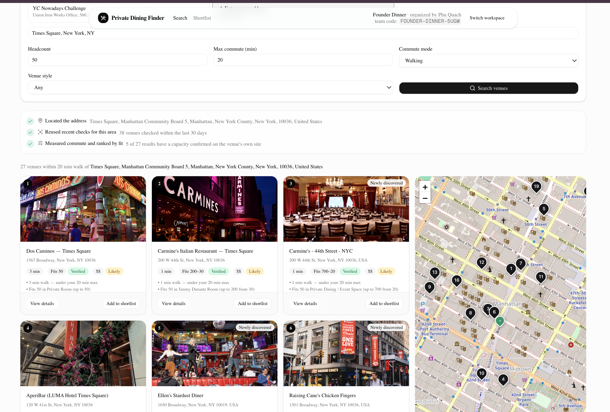
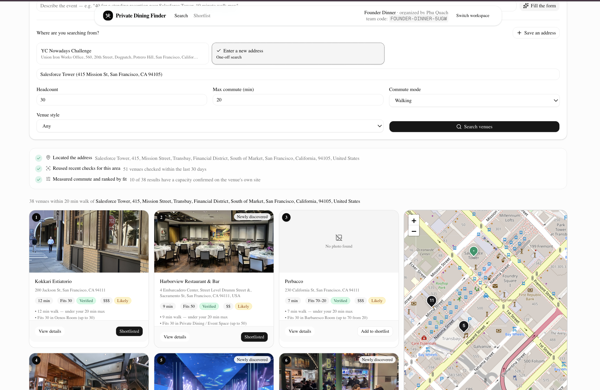
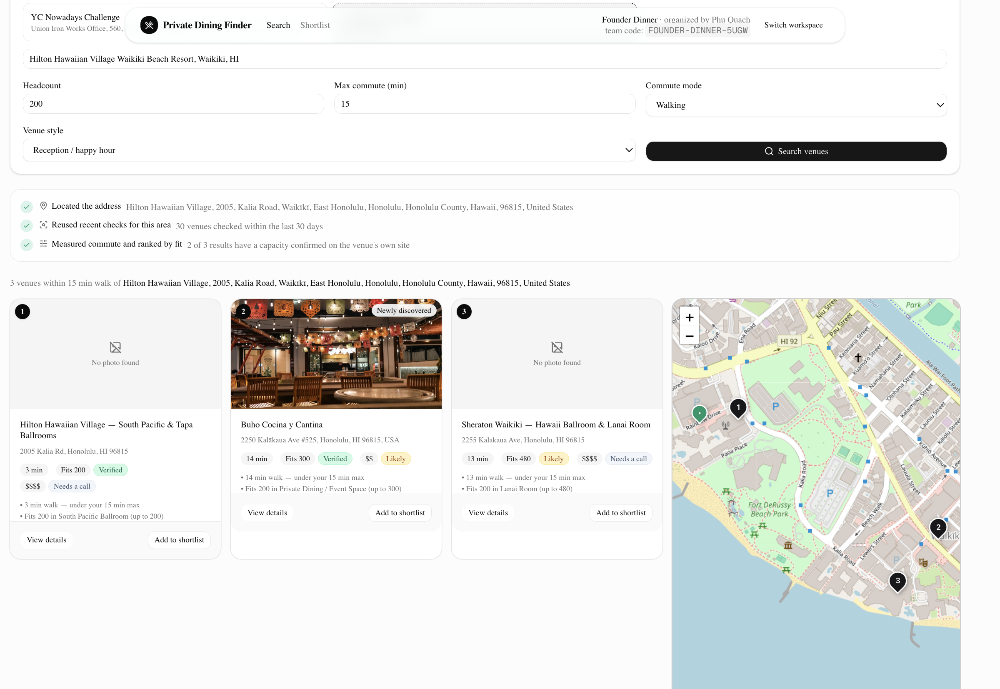

# Private Dining Finder

Private Dining Finder helps event planners find a restaurant or venue with a private room that fits their group, within a set commute of the office. Each venue's capacity is read from its own website and checked against the source text. Every figure carries a trust label, and results are ranked by the probability that the venue can actually host the group.

CECS 451 (Artificial Intelligence) course project. Built with Next.js 16, Supabase and xAI Grok.

## Contents

1. [Project description](#1-project-description)
2. [Problem](#2-problem)
3. [Solution](#3-solution)
4. [Architecture and project structure](#4-architecture-and-project-structure)
5. [AI algorithms](#5-ai-algorithms)
6. [Getting started](#6-getting-started)
7. [Known limitations](#7-known-limitations)

## 1. Project description

### Demo

[Demo video](https://youtu.be/1DjUHycWY70)

### Features

| Feature               | Description                                                                                                                                                                                                         |
| --------------------- | ------------------------------------------------------------------------------------------------------------------------------------------------------------------------------------------------------------------- |
| Search                | Filter by office address, headcount, maximum commute, walk or drive, and room style. A plain-English request ("40 people, 10-minute walk, seated") can fill in the form.                                            |
| Venue discovery       | When an area has fewer than three recently checked venues, the app finds new candidates, reads their websites and extracts room capacities.                                                                         |
| Ranking               | Venues are ranked by expected utility, which combines commute, room fit and the probability that the room really fits. A room scored by the capacity model lists "About N% likely to fit your group".               |
| Trust labels          | A capacity the model scored shows Verified, “Likely, call to confirm”, or Unverified from its probability. A planner confirmation and a category estimate keep their own labels. Price figures use the trust names. |
| Shortlist and compare | Save candidates, compare rooms, prices and commute times side by side, and choose one.                                                                                                                              |
| Event page            | A shared page where guests post allergies and dietary needs in real time. The app summarises them into a roster for the venue.                                                                                      |
| Shared catalog        | A planner who confirms a figure with the venue updates it for later searches. Confirmations that contradict strong evidence are held for review.                                                                    |

The application supports research and coordination only. It does not make bookings or payments.

### Screenshots

| New York (Times Square)                        | San Francisco (Salesforce Tower)                               | Waikiki (Hilton Hawaiian Village)          |
| ---------------------------------------------- | -------------------------------------------------------------- | ------------------------------------------ |
|  |  |  |

## 2. Problem

Finding a private room for 30 to 200 people is mostly manual research.

- **No structured source exists.** No public API lists private rooms and their capacities. The information sits on each venue's events page, in PDFs, on JavaScript-rendered sites, or only with the venue's staff.
- **Capacity is stated inconsistently.** Sites write "seats 40", "up to 120 guests for receptions", or describe a room without giving any number.
- **Reliability is not visible.** A planner's notes mix confirmed figures, estimates and outdated listings, with no record of which is which.
- **Simple automation introduces errors.** A keyword scraper can take "our dining room seats 180" from a homepage and report it as a private room. A language model can produce a capacity that the page never states.

The main risk is booking a room that cannot hold the group.

## 3. Solution

The system attaches evidence to each capacity figure and ranks venues by how likely that figure is to be correct.

1. **Discovery.** Candidates come from Google Places and OpenStreetMap. A hand-set prior decides which candidates receive the limited budget of page renders and model calls.
2. **Two independent readers.** A pattern matcher and a language model each read the venue's private-dining page. The model must return the exact sentence that supports each capacity.
3. **Grounding.** A model answer is kept only if its quoted sentence appears on the page and contains the number. The number a room shows is the one with the most votes, a grounded quote, and a regex hit.
4. **Confidence.** Each room receives a probability that its capacity is correct, computed from the evidence features.
5. **Ranking.** Expected-utility ranking ensures an estimated capacity cannot outrank a published one simply because the estimate is closer to the headcount.
6. **Planner feedback.** Figures confirmed by phone are written back to the shared catalog, with a check against likely input errors.

Only the Supabase keys are required. Each paid service (Google Places, Firecrawl, xAI, OpenRouteService) has a free fallback, and results produced by a fallback are labelled as such.

## 4. Architecture and project structure

### System architecture


The planner uses the browser pages. Server Actions and the ranking engine run on the Next.js server. The discovery pipeline calls geocoding, commute, venue search, page rendering, and Grok. Supabase stores the catalog and the live event chat. The steps below are what one search does inside that pipeline.

| Step | Description                                                                           | Source                                      |
| ---- | ------------------------------------------------------------------------------------- | ------------------------------------------- |
| 1    | Geocode the office address                                                            | `src/lib/geo/geocode.ts`                    |
| 2    | Cache check: at least three nearby venues checked in the last 30 days skips to step 8 | `src/lib/discovery/ensure-coverage.ts`      |
| 3    | Find candidates in Google Places and OpenStreetMap; merge duplicates within 75 m      | `src/lib/discovery/places.ts`               |
| 4    | Order candidates by the discovery prior                                               | `src/lib/discovery/discovery-prior.ts`      |
| 5    | Check robots.txt, fetch the site, render JavaScript-only pages with Firecrawl         | `scraper.ts`, `robots.ts`, `render.ts`      |
| 6    | Extract capacities with the regex reader and the LLM reader                           | `scraper.ts`, `llm-extract.ts`              |
| 7    | Grounding check, trust tier and confidence score; save to Postgres                    | `grounding.ts`, `trust.ts`, `confidence.ts` |
| 8    | Commute times from the OpenRouteService matrix, or a labelled estimate                | `src/lib/geo/commute.ts`                    |
| 9    | Expected-utility ranking                                                              | `src/lib/ranking.ts`                        |
| 10   | Result cards and map                                                                  | `src/components/venue-card.tsx`             |

### Technology stack

| Layer                 | Technology                                                                                                        |
| --------------------- | ----------------------------------------------------------------------------------------------------------------- |
| Framework             | Next.js 16 (App Router, Server Components, Server Actions), React 19, TypeScript                                  |
| UI                    | Tailwind CSS 4, shadcn/ui, Leaflet (2D map), MapLibre GL (3D map)                                                 |
| Database              | Supabase: Postgres 17, row-level security, Realtime                                                               |
| Language model        | xAI Grok (`XAI_MODEL`, default `grok-4.7`) over HTTPS, JSON-schema structured output                              |
| Venue data            | Google Places API (New), OpenStreetMap Overpass                                                                   |
| Page rendering        | Firecrawl v2, used only for JavaScript-rendered pages                                                             |
| Routing and geocoding | OpenRouteService Matrix, Nominatim, Photon                                                                        |
| Testing               | Vitest                                                                                                            |
| Offline training      | Python, scikit-learn, DuckDB (Foursquare OS Places). Training and test labels are human labels by Thien Phu Quach |

### Project structure

```
CECS451/
├── architecture/              Architecture diagram and screenshots
├── eval/                      Training data, review tool, data card, metrics and baselines
├── ml/                        Python: model training and evaluation
├── public/                    Static assets (curated venue photos)
├── scripts/
│   ├── seed.ts                Load the curated venues, then look up their photos
│   ├── backfill-photos.ts     Add Google photos to venues without one
│   ├── test-scenarios.ts      Run the three reference searches
│   ├── data/                  Training pipeline (sample through extraction eval
│   │                          and the confidence backfill) and the offline dry run
│   ├── eval-ranking.ts        NDCG@5 for each ranking method
│   ├── verify-*.ts            Checks against the live external services
│   └── loadtest-density.ts    Cold-discovery timing in a dense area
├── src/
│   ├── app/                   Routes: /, /start, /search, /venue/[id], /shortlist,
│   │   │                      /compare, /summary/[code], /event/[code]
│   │   ├── actions.ts         Server Actions (all writes)
│   │   └── api/               place-photo (photo proxy), geocode-suggest
│   ├── components/            Search form, venue card, map, event chat, dietary panel
│   ├── data/                  Curated venues and model coefficients (JSON)
│   └── lib/
│       ├── discovery/         Places, scraper, robots.txt, rendering, LLM extraction,
│       │                      grounding, trust, confidence, discovery prior, pipeline
│       ├── geo/               Geocoding, commute matrix, bounding boxes
│       ├── ranking.ts         Expected-utility ranking
│       ├── nl-query.ts        Plain-English search parsing
│       ├── dietary-summary.ts Dietary roster from the event chat
│       ├── corroboration.ts   Review rule for planner confirmations
│       └── supabase/          Database clients and types
├── supabase/migrations/       Database schema, 0001 to 0011
```

## 5. AI algorithms

The system combines three Grok tasks with three logistic models trained offline (`ml/`, steps in [`eval/README.md`](eval/README.md)). The room sizes and hosts labels used for that training were labeled by Thien Phu Quach. Capacity confidence is loaded from `src/data/confidence-model.json`. Discovery order and the fit curve stay on the hand-set rules; those trained files were not loaded.

### 5.1 Components

| Component           | Method                 | Purpose                                               |
| ------------------- | ---------------------- | ----------------------------------------------------- |
| Query parsing       | LLM, structured output | Convert a plain-English request into search fields    |
| Capacity extraction | Regex and LLM          | Read room names and capacities from a venue's site    |
| Grounding           | Deterministic check    | Reject model answers the page does not support        |
| Capacity confidence | Logistic regression    | Probability that a stored capacity is correct         |
| Discovery prior     | Logistic regression    | Probability that a candidate hosts private events     |
| Ranking             | Expected utility       | Order venues by the expected value of contacting them |
| Dietary roster      | LLM, structured output | Summarise guests' messages into per-person needs      |

All language-model calls use xAI Grok (`XAI_MODEL`, default `grok-4.7`) with a strict JSON schema. Query parsing and the dietary roster run at temperature 0; capacity extraction makes three reads at temperature 0.7 (Section 5.2). Each call has an input limit, a timeout and a non-model fallback, so the application keeps working when the model is unavailable.

### 5.2 Capacity extraction

Each venue's capacity is read by two independent readers.

- **Regex reader.** It matches phrases such as "seats 40" or "up to 120 guests". For each match it records the surrounding sentence and the nearest room name. Values below 6 and reservation phrases ("table for 2") are discarded.
- **LLM reader.** It reads the private-dining page (up to 12,000 characters) three times in parallel at temperature 0.7 and returns each room with its capacity and an `evidenceQuote`: the exact sentence that states the capacity. A room's capacity is the most common answer across the reads; its **self-consistency** is the share of reads within 10% of that answer (Wang et al., 2022).

The private-dining page is read before the homepage, because homepage figures usually describe the main dining room rather than a private space.

### 5.3 Grounding

A model answer is accepted only when two conditions hold:

1. its `evidenceQuote` appears on the page, after case, whitespace and quotation marks are normalised; and
2. the quote contains the capacity, written in digits or in words.

Answers that fail either condition are discarded. The approach follows the citation checking in ALCE (Gao et al., 2023), but uses an exact match in place of a second model.

### 5.4 Trust labels

A room the confidence model scores shows a label from its probability. The cutoffs are fixed at 0.90 and 0.60.

| Probability     | Label shown             |
| --------------- | ----------------------- |
| 0.90 and above  | Verified                |
| 0.60 up to 0.90 | Likely, call to confirm |
| Below 0.60      | Unverified              |

A planner confirmation stays `confirmed_by_planner` (stored at 0.98, above every model score). A category estimate has no number on the page, so it stays an estimate and the card says "Capacity unpublished". The room note still records how the number was read: the two readers agreed within 20%, they disagreed, only the regex matched, or only the grounded model read produced a figure.

### 5.5 Capacity confidence

The number a room displays is chosen by votes plus a grounded quote plus a regex hit. A logistic model then scores that number, P(it is within 10% of the truth):

```
confidence = σ(b + Σ wᵢ xᵢ),    σ(z) = 1 / (1 + e^(−z))
```

The features `xᵢ` are computed by one function (`src/lib/discovery/features.ts`) for both training and the app: how many reads named the number, whether the regex and a grounded quote did, words near the number, and where it sits among the other numbers on the page. The score is computed once, when the venue is saved, and stored in place of the tier weight. It is capped at 0.979 so a planner-confirmed room (0.98) stays above it. A category estimate, which has no number on the page, keeps the fit-prior path. "% likely to fit" is shown only for a room this model scored. A room with no stored score still uses its tier weight (verified 0.9, likely 0.6, ai_extracted 0.45, unverified 0.3).

### 5.6 Discovery prior

Each search is limited to 10 Firecrawl renders and 12 LLM reads. Before this budget is spent, every candidate is scored with a hand-set prior:

```
P(hosts private events) = σ(b + w · features)
```

The weights cover place type, price level, whether the venue has a website, and keywords in the name. Candidates are processed in descending order of this score. A learned prior was fit offline and was not loaded, because it does not keep that order.

### 5.7 Expected-utility ranking

```
pFit  = p · 1[room fits] + (1 − p) · q     p = capacity confidence
pFit  = q                                  when the capacity is an estimate

U     = 0.5 · commute score + 0.35 · capacity fit + 0.15 · style match

score = pFit · U − (1 − pFit) · λ          λ = 0.25
```

`q` is the base rate at which a venue of the given category has a space for `h` guests. The app uses a hand-set logistic curve in `h`. A learned table was fit offline and was not loaded: on the hosts-yes denominator, a restaurant at 200 guests is 0.21, above the ranking bound of 0.20. `λ` is the cost of contacting a venue that turns out not to fit.

Venues with `pFit < 0.2` are excluded, as are rooms that are too small with confidence of 0.85 or more. Ties are broken by `pFit`, then commute time, then name. This follows the maximum expected utility principle (Russell and Norvig, ch. 16): an unconfirmed estimate contributes utility only in proportion to the belief that it is correct.

### 5.8 Safeguards

- **robots.txt (RFC 9309).**
  - The longest matching rule applies, and Allow wins a tie.
  - A 4xx response permits crawling.
  - A 5xx or unreachable robots.txt means the site is skipped and marked for a phone call.
- **Planner corroboration.** A confirmation is held for review instead of being applied when the room's confidence is at least 0.85 and the reported figure differs by more than 50%.
- **Separate queues.** Scraping and model calls run in separate queues, eight at a time, so a slow model call does not hold up scraping.

### 5.9 Evaluation

The training pipeline (`scripts/data/`, `ml/`, described in [`eval/README.md`](eval/README.md)) reports, on held-out gold venues and separately on LA (a city never trained on):

| Metric                                                           | Measures                                                                                                                               |
| ---------------------------------------------------------------- | -------------------------------------------------------------------------------------------------------------------------------------- |
| Room precision, recall, F1 and invented-number rate              | Extraction quality: v0 regex maximum, regex candidates, one LLM read, and the shipped three-read grounded extraction                   |
| Log loss, Brier score, ROC AUC, ECE (equal-width and equal-mass) | Confidence model against the v0 tier weights, an evidence lookup table and a constant                                                  |
| AUC and yield@10/25                                              | Discovery prior against the v0 prior and random order                                                                                  |
| Human labels                                                     | Room sizes and hosts labels for training and testing, labeled by Thien Phu Quach. Per-item accuracy and Cohen's kappa are not reported |
| NDCG@5, gain 2^rel − 1                                           | Ranking quality against human judgments (`scripts/eval-ranking.ts`)                                                                    |

Metric implementations are cross-checked against scikit-learn, and the TypeScript model scoring is checked against scikit-learn's `predict_proba` to 1e-6. `npm run data:dryrun` runs the whole pipeline offline on synthetic data.

## 6. Getting started

These steps run the app on your machine. Python and the files in `ml/` are only for the offline training pipeline. Leave the optional API keys blank for the first run. The curated venues cover the three reference searches.

### Prerequisites

- Node.js 20.9 or later
- Docker Desktop, running, for the local database
- A network connection. The first database start downloads images, and `npm run seed` geocodes addresses

### Installation

```bash
git clone https://github.com/quachphu/CECS451.git
cd CECS451
npm install
cp .env.example .env.local
npx supabase start
```

The first `npx supabase start` can take several minutes. It applies every file in `supabase/migrations/`. When it finishes, copy three values from that output into `.env.local`:

| Line in the start output        | Variable in `.env.local`        |
| ------------------------------- | ------------------------------- |
| Project URL, or API URL         | `NEXT_PUBLIC_SUPABASE_URL`      |
| Publishable key, or anon key    | `NEXT_PUBLIC_SUPABASE_ANON_KEY` |
| Secret key, or service_role key | `SUPABASE_SERVICE_ROLE_KEY`     |

The local API URL is `http://127.0.0.1:54321`. Studio is at `http://127.0.0.1:54323`. Then load the curated venues and start the app:

```bash
npm run seed
npm run dev
```

Open `http://localhost:3000`, choose **Create workspace**, and search one of the reference addresses below. `npm run seed` is safe to run again. `npx supabase stop` shuts the local database down. `npx supabase db reset` reapplies the migrations and then you run `npm run seed` again.

### Environment variables

| Variable                        | Required | Behaviour when unset                                                                                      |
| ------------------------------- | -------- | --------------------------------------------------------------------------------------------------------- |
| `NEXT_PUBLIC_SUPABASE_URL`      | Yes      | The app will not start                                                                                    |
| `NEXT_PUBLIC_SUPABASE_ANON_KEY` | Yes      | The app will not start                                                                                    |
| `SUPABASE_SERVICE_ROLE_KEY`     | Yes      | The app will not start, and `npm run seed` exits with an error                                            |
| `GOOGLE_PLACES_API_KEY`         | No       | Discovery uses OpenStreetMap only; venues have no photos                                                  |
| `XAI_API_KEY`                   | No       | No LLM reader, query parsing, or dietary roster. A number still on the page is scored from the regex path |
| `FIRECRAWL_API_KEY`             | No       | JavaScript-rendered pages are marked for a phone call                                                     |
| `ORS_API_KEY`                   | No       | Commute times are straight-line estimates, labelled as such                                               |

`.env.local` is excluded from version control. Copy `.env.example` rather than inventing names. A hosted Supabase project may show `sb_publishable_...` and `sb_secret_...` keys. Those go in the anon and service-role variables above.

### Hosted database

Use this only if you already have a Supabase project. Put that project's URL and keys in `.env.local` (Project Settings, then API), then:

```bash
npx supabase login
npx supabase link --project-ref <project-ref>
npx supabase db push
npm run seed
npm run dev
```

### Running

```bash
npm run dev                          # development server at http://localhost:3000
npm run build && npm run start       # production build
```

### Reference scenarios

| Scenario                                              | Address                                   |
| ----------------------------------------------------- | ----------------------------------------- |
| 50 people, under 20 minutes                           | `Times Square, New York, NY`              |
| 30 people, under 15 minutes                           | `415 Mission St, San Francisco, CA 94105` |
| 200 people, reception style, under 15 minutes walking | `Hilton Hawaiian Village, Honolulu, HI`   |

### Commands

| Command                      | Description                                                  |
| ---------------------------- | ------------------------------------------------------------ |
| `npm test`                   | Unit and integration tests                                   |
| `npm run lint`               | ESLint                                                       |
| `npm run test:scenarios`     | Run the three reference searches                             |
| `npm run photos:backfill`    | Add Google photos to venues without one                      |
| `npm run eval:ranking`       | NDCG@5 for each ranking method                               |
| `npm run data:dryrun`        | Run the whole training pipeline offline on synthetic data    |
| `python3 -m pytest ml/tests` | Python tests (requires `pip install -r ml/requirements.txt`) |

The training pipeline's steps are listed in [`eval/README.md`](eval/README.md).

The scripts in `scripts/verify-*.ts` and `scripts/loadtest-density.ts` call the live external services and use API credits. Run them with `npx tsx scripts/<name>.ts`. Scripts that import server modules need `node --conditions=react-server --import tsx scripts/<name>.ts`.

### Troubleshooting

| Symptom                                                      | Resolution                                                                                              |
| ------------------------------------------------------------ | ------------------------------------------------------------------------------------------------------- |
| `supabase start` cannot reach Docker                         | Start Docker Desktop and run `npx supabase start` again                                                 |
| `Set NEXT_PUBLIC_SUPABASE_URL and SUPABASE_SERVICE_ROLE_KEY` | Copy the three values from `npx supabase start` into `.env.local`, then run `npm run seed` again        |
| `Failed to write rooms … is 0011_ai_core.sql applied?`       | Run `npx supabase db reset` locally, or `npx supabase db push` on a hosted project, then `npm run seed` |
| Venue cards show "No photo found"                            | Set `GOOGLE_PLACES_API_KEY`, run `npm run photos:backfill` and restart the server                       |
| Port 3000 is in use                                          | `npm run dev -- -p 3001`                                                                                |
| Plain-English search reports that the model did not respond  | Check `XAI_API_KEY`; the standard search form works without it                                          |

## 7. Known limitations

- **Small training base.** The 58 correct numbers used for training come from only 15 venues. Los Angeles calibration error is higher (0.085).
- **Not every venue appears.** Each search reads a limited number of websites to keep it fast and affordable.
- **USA only.** We built and tested the app only in four U.S. cities: New York, San Francisco, Honolulu, and Los Angeles. Other countries will not work.
- **Some sites are left for a phone call.** When a site blocks automated reading,
  or the only capacity is in a PDF or an image, the venue is marked for the planner
  to confirm.

## References

- Gao et al., _Enabling Large Language Models to Generate Text with Citations_ (ALCE), EMNLP 2023
- Guo et al., _On Calibration of Modern Neural Networks_, ICML 2017
- Wang et al., _Self-Consistency Improves Chain of Thought Reasoning in Language Models_, 2022
- Niculescu-Mizil and Caruana, _Predicting Good Probabilities with Supervised Learning_, ICML 2005
- Russell and Norvig, _Artificial Intelligence: A Modern Approach_, 4th ed., ch. 16
- Järvelin and Kekäläinen, _Cumulated Gain-Based Evaluation of IR Techniques_, ACM TOIS 2002
- Cohen, _A Coefficient of Agreement for Nominal Scales_, 1960
- RFC 9309, _Robots Exclusion Protocol_
